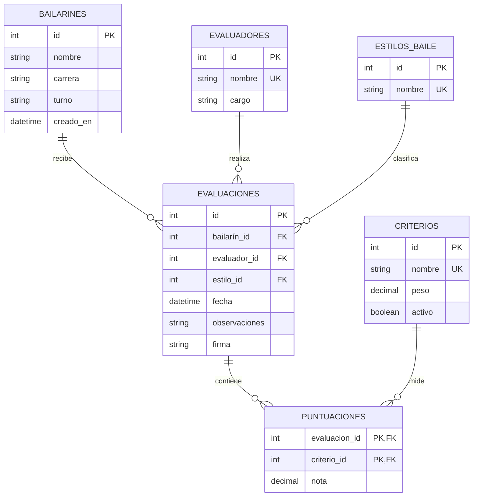

# Formulario de evaluación de baile

<!-- Josue Ramos expone este documento: normalizacion, modelo E-R, consultas y vistas. -->

## Diagrama entidad-relación



## Modelo relacional

- `BAILARINES(id PK, nombre, carrera, turno, creado_en)`
- `EVALUADORES(id PK, nombre UNIQUE, cargo)`
- `ESTILOS_BAILE(id PK, nombre UNIQUE)`
- `CRITERIOS(id PK, nombre UNIQUE, peso, activo)`
- `EVALUACIONES(id PK, bailarín_id FK, evaluador_id FK, estilo_id FK, fecha, observaciones, firma)`
- `PUNTUACIONES(evaluacion_id PK/FK, criterio_id PK/FK, nota)`

Las relaciones de puntuación tienen clave primaria compuesta `(evaluacion_id, criterio_id)`, por lo que un criterio solo puede calificarse una vez por evaluación. Las claves foráneas se aplican en SQLite; las notas actuales deben estar entre 0 y 25. La planilla utiliza cuatro criterios: técnica, expresión y arte, coreografía, y vestuario y puesta en escena; juntos suman un máximo de 100 puntos. Los criterios anteriores se conservan inactivos para mantener el historial al actualizar una base de datos existente.

## Normalización

- **1FN:** cada columna guarda un valor simple. Las notas por criterio no se almacenan como columnas repetidas en `EVALUACIONES`; cada nota es una fila de `PUNTUACIONES`.
- **2FN:** en `PUNTUACIONES`, `nota` depende de la clave completa `(evaluacion_id, criterio_id)`. Los nombres y pesos del criterio viven en `CRITERIOS`, no dependen solo de una parte de esa clave.
- **3FN:** los datos del bailarín, evaluador, estilo y criterio se guardan en sus catálogos. En `EVALUACIONES` solo se conservan las claves foráneas y los datos propios de la sesión, evitando dependencias transitivas y duplicación de nombres.

## Vistas y consultas

La aplicación crea y consulta principalmente estas vistas:

- `v_evaluation_summary`: una fila por evaluación, con participante, carrera, turno, título del baile, jurado, firma, fecha y promedio de notas sobre 25.
- `v_criterion_performance`: una fila por criterio, con cantidad de notas y promedio histórico.

Consultas usadas por el tablero y reportes:

```sql
-- Resumen general derivado de la vista de evaluación
SELECT COUNT(*) AS evaluaciones,
       COUNT(DISTINCT dancer_name) AS bailarines,
       ROUND(AVG(average_score), 1) AS promedio_general
FROM v_evaluation_summary;

-- Resultados recientes para el listado y el PDF
SELECT dancer_name, career, shift, dance_style, evaluator_name,
       evaluated_at, average_score
FROM v_evaluation_summary
ORDER BY evaluated_at DESC;

-- Criterios con mejor promedio
SELECT criterion_name, score_count, average_score
FROM v_criterion_performance
ORDER BY average_score DESC, criterion_name;

-- Detalle de notas de una evaluación
SELECT c.name AS criterio, s.score AS nota
FROM scores s
JOIN criteria c ON c.id = s.criterion_id
WHERE s.evaluation_id = ?
ORDER BY c.id;
```

## Ejecución

Con Flutter instalado y Android Studio/emulador configurado:

```powershell
flutter pub get
flutter run
```

El proyecto incluye el código Flutter; `android/` debe generarse una sola vez si aún no existe, desde el menú **Flutter: New Project** o copiando la carpeta Android de un scaffold temporal creado con `flutter create`.

Para generar el informe PDF, abre **Consultas** y pulsa el botón PDF. `printing` abre la vista de impresión/compartir disponible en el dispositivo.